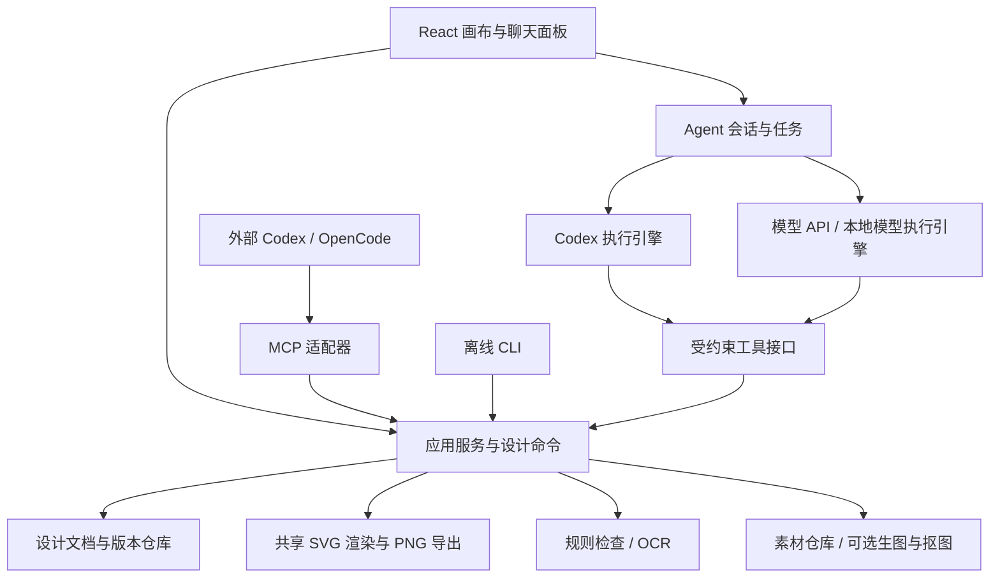

# Poster Agent AI 画布重构设计

状态：设计草案，待用户审阅；本文不是已实现能力清单。

## 1. 产品目标与求职定位

用户已确定：以 Adobe Express 的对话创作与逐图层编辑、Canva 的可编辑设计接口为参考，完善用于 AI 应用 / Agent 开发求职的项目。保留被 Codex 等外部 Agent 调用、多模型提供商、纯脚本离线运行与本地开源模型执行的目标，并支持类似 OpenCode 的 Codex 账号登录体验。

产品定位：本地优先的电商海报 AI 画布。用户和 Agent 操作同一份可编辑设计，能够生成、局部修改、检查、撤销、保存与导出。

求职展示的核心问题：如何让 Agent 理解设计上下文，准确执行局部编辑，在用户同时编辑、模型出错和网络中断时保住正确状态，并用真实证据评价任务完成度。

以下为设计者建议，尚未得到逐项确认：单用户本机部署；延续 Python/FastAPI 与 React/TypeScript；单页画布；先做模板与有限图层；不以通用设计软件的功能数量作为目标。

## 2. 来源与参考边界

- Adobe 官方介绍：https://news.adobe.com/news/2025/10/adobe-max-2025-express-ai-assistant 。参考对话与手动编辑交替、理解设计上下文、只修改目标图层的产品行为。
- Canva Design Editing API：https://www.canva.dev/docs/apps/design-editing/ 。参考设计元素、设计快照、同步和冲突边界。
- Codex App Server：https://learn.chatgpt.com/docs/app-server 。参考官方登录、会话、审批和流式事件接入。
- Sign in with ChatGPT 的 Codex 适配：https://developers.openai.com/siwc/token-sharing-open-source/codex-app-server 。账号与部署接入在实施时复核官方支持范围。

这是自主实现的产品与领域模型，不接入 Canva/Adobe 商业编辑器，不声称采用它们的内部架构。账号可用不代表具备所有文本、视觉或生图能力；每种能力需要独立验证。

## 3. 当前代码证据

| 当前证据 | 重构含义 |
| --- | --- |
| `app/schemas.py` 的 PosterSpec、LayerLayoutV1 | 规格、离散模板与有限偏移已存在，还不是通用可编辑文档 |
| `app/compositor.py`、`app/native_layout.py` | 保留旧版确定性渲染；新画布不直接扩大旧规格字段 |
| `app/storage.py` | 已有本地素材、PNG/JSON 版本、暂存发布；新文档应有独立版本命名空间 |
| `app/brief_compiler.py`、`app/image_provider.py` | 文本和背景生成绑定 Qwen，需要提取能力适配边界 |
| `app/review_service.py`、`app/workflows/review_graph.py` | 已有人工确认和 SQLite checkpoint，可复用原则，但不能直接当作新 Agent 执行器 |
| `app/execution_store.py` | 已有幂等与结果未知状态，需保留并明确新旧账本关系 |
| `app/cutout_service.py`、`app/ocr_provider.py` | 已有本地模型相关能力，继续通过独立工具接入 |
| `docs/react-workbench.md`、`frontend/src/workbench.js` | React 结构仍与旧 DOM 控制器并存；新画布不能与旧控制器共同写状态 |

上述为源码与文档核查，不代表本次重新运行过测试或真实模型。本设计不引用历史测试数量作为当前通过证据。

## 4. 第一版用户闭环

1. 创建项目，上传商品和可选 Logo，填写或描述标题、价格与风格。
2. Agent 将需求转换为受约束的设计意图，缺少价格等业务事实时询问，不编造。
3. 选择一份模板，生成一份可编辑设计。首版只生成一份方案，避免把多候选编排放进主路径。
4. 用户在画布选中图层，手动拖动、改文字、改颜色；支持键盘选中与数值属性编辑。
5. 用户说“把选中的价格放大，商品和 Logo 保持不变”，Agent 读取选择与版本，提出结构化修改。
6. 展示修改预览和目标图层，用户应用或取消；应用后生成新版本，可撤销、重做。
7. 执行几何、文本与可选 OCR 检查；展示检查依据和不确定项。Agent 至多进行有限轮次修正。
8. 保存并重新打开设计，导出 PNG 与可重新导入的项目包。

演示必须包含一次错误恢复，例如 Agent 修改期间用户先改了价格，旧修改被拒绝，Agent 读取新状态后重新提出修改。

## 5. 架构与所有权

- 文档服务是持久状态的唯一写入者。浏览器、内部 Agent、外部 MCP、CLI 都提交同一套命令。
- 画布拥有临时选择、缩放与拖动预览，不直接写数据库。拖动结束按一条命令提交；一次撤销对应一次完整操作。
- Agent 运行记录保存消息、工具请求、状态与关联版本，不作为设计文档的替代存储。
- 应用服务不依赖 HTTP、MCP 或 Codex。适配器不直接改素材文件或版本文件。
- 原有海报流程继续运行。新画布使用独立的接口、数据目录与 React 状态，避免一次性重写审核与批量模块。

## 6. 文档、命令与持久化

### 6.1 可编辑文档

`DesignDocument` 包含 schema_version、document_id、revision、单个 page、nodes、asset_refs、font_refs、业务事实与来源。

- 页面：宽、高、背景色；首版 1024×1024，其他尺寸另行创建派生文档。
- 图层：稳定 node_id、类型、语义角色、位置、大小、旋转、透明度、可见性、锁定状态与顺序。
- 类型：text、image、rect。背景图也属于 image；首版不做任意路径、嵌入 HTML、脚本或远程 SVG。
- 语义角色：title、subtitle、price、original_price、product、logo、background、cta、decoration。
- 文字使用显式文本框、受支持字体和排版属性。价格保留 Decimal 字符串及币种，文本由业务值格式化。
- 素材通过不可变 asset_id 和内容哈希引用。模型不能提交任意服务器文件路径或由渲染器访问的远程地址。
- 锁定图层拒绝手动和 Agent 修改，用户须显式解锁。商品与 Logo 不因风格修改被替换。

首版模板是可验证的文档生成函数。模型生成设计意图和命令，不生成任意 SVG/HTML/JS。更自由的布局规划留待后续。

### 6.2 统一命令

首版包括 CreateFromTemplate、SetText、SetPrice、SetStyle、TransformNode、ReplaceImage、ReorderNode、SetNodeLock、AddNode、RemoveNode、Undo、Redo。坐标、尺寸、角色、资产归属与可编辑属性在服务端校验。

每次提交带 `command_id`、`expected_revision`、actor、有界 operations。命令批次全部成功才提交一个新 revision；任一操作失败不得部分修改。相同 command_id 与相同输入返回原结果；换输入返回冲突。

`SetPrice` 是专门的业务操作，不能用 SetText 绕过价格校验；用户明确提供的新价格可修改，否则必须补充确认。AI 对文案的内容不得改变用户提供的商品事实。

### 6.3 版本和恢复

新设计使用独立 `designs.sqlite3` 和内容寻址的素材/导出目录。SQLite 事务存不可变文档快照、父 revision、命令摘要、命令幂等记录、会话、run 与工具事件。事件日志用于诊断和回放，首版不建设事件溯源系统。

素材先完成有界解码、哈希与原子发布，再被事务引用；崩溃遗留的无引用素材可后续清理，不允许出现已提交文档引用半写文件。预览/导出属于派生产物，失败不回滚已保存文档，可按 revision 与渲染版本重建。

Undo/Redo 创建新 revision，不减少版本号，不删除历史。提交必须携带当前 expected_revision。Undo 可撤销最新的一次已提交编辑，UI 展示其 actor；新的普通编辑清除 redo 分支。用户确认过的 AI 批次是一个撤销单位。所有入口使用相同规则。

版本快照是权威状态，原始素材不可变。技术检查和人工审核分别绑定文档 revision、素材哈希及导出哈希；修改后旧结果只能历史查看。

## 7. Agent 执行设计

### 7.1 上下文与工具

给模型的上下文包含用户需求、文档摘要、当前 revision、选中图层及角色、允许操作、锁定状态、业务事实；支持视觉输入时附同版本预览。原图/预览送云端的行为要在配置和首次使用时说明；离线模式禁止云端发送。

工具首版包括 read_design、read_selection、list_templates、propose_edit、render_preview、inspect_design、get_run、export_design。修改工具返回候选命令和预览，不直接提交。用户通过应用服务应用候选；外部 Agent 也必须显式调用 apply_proposal，并遵循会话预先授权的编辑范围。只读连接没有写权限。

模型不得调用任意 Python、shell、网络或数据库。新引擎不暴露通用执行工具。Codex 适配需验证能限制其工具和写入范围；不能成立时不开放该适配的写操作，并记录为尚未通过验收，不能以提示词代替约束。

### 7.2 有界执行与检查

一次 run 固定最大 12 次工具调用、最多 2 次修正、总耗时 120 秒；这些是本地配置默认值，实施时可依据真实测量调整并记录。生成背景等耗时操作是单独子任务，不在上述限时内偷偷继续。

检查分三类：结构/几何确定性检查；可选 OCR 检查；模型视觉建议。后两者缺失或不确定必须明确标示，模型认为“好看”不能写成验收 PASS。

每轮预览固定 document revision、asset hashes、renderer version；检查报告与该预览绑定。Agent 可根据几何失败提出修正，用户应用前仍保持候选状态。

### 7.3 状态、冲突与异常

run 状态：QUEUED、RUNNING、WAITING_INPUT、WAITING_APPROVAL、COMPLETED、FAILED、CANCELLED、UNKNOWN。每个工具调用记录 run_id、call_id、输入摘要、输出摘要、耗时和可用的实际用量；隐藏推理不采集，凭证不入日志。

用户在模型运行期间可以编辑。候选绑定 base_revision；应用时版本过期返回 REVISION_CONFLICT，不自动覆盖或合并。Agent 读取新快照后重新提出候选。

取消阻止后续工具和提交；不宣称撤销已经发出的外部请求。付费或外部执行超时且结果无法确认时记 UNKNOWN，不自动重新消费。重启后运行中任务转 UNKNOWN，等待查询或显式重新执行；已提交版本和可恢复事件仍可查看。

## 8. 多引擎与离线边界

区分 AgentEngine、ModelProvider 与 Image/OCR/Cutout Provider。

- CodexEngine：通过官方 App Server 管理登录、会话与事件；与海报工具连接。管理完整的 Agent 会话，不伪装成普通 chat/completions 提供商。
- ModelAgentEngine：由项目实现相同的有界工具循环。首先接入已有 Qwen 文本调用，再增加一种本地文本模型服务；使用现有 LangGraph 依赖承载持久中断与恢复，不同时再引入第二套 Agent 框架。
- ImageProvider、OCRProvider、CutoutProvider：独立能力接口，不依赖所选文本引擎。保留现有 Qwen 生图与本地 OCR/抠图的适配入口。
- NoneEngine：不调用模型，CLI/工作台按模板与显式命令工作，是可复现的离线基线。

能力注册明确 text、vision、tool_calling、structured_output、image_generation、local_execution；UI 根据实际能力启用操作。协议兼容不等于能力兼容，模型列表不当作权限验证。

离线分两种：纯脚本无需模型；本地模型需要预装权重、运行时与字体。两者均不能隐式下载或退回云端。端点来自受信任本机配置，不能由模型或普通请求任意指定。硬件、模型与许可选择在实施阶段根据本机条件和可分发范围确定。

Codex 账号登录通过官方流程完成，凭证交给官方运行时或系统凭证库，不抓取浏览器会话，不将 token 写进项目。先支持用户自行安装的兼容 Codex 运行时，固定验证版本，缺失时提供安装说明。若以后分发托管/商业服务，需重新核验官方接入路径。首版不把某账号可登录等同于可免费生图。

## 9. 画布和导出技术决策

建议首版采用受约束的 SVG 文档渲染，React 外层提供选择框、缩放、拖动与属性面板。React 不另建一份渲染语义；预览 SVG 和无界面导出都调用同一个服务端文档到 SVG 转换器。

文字换行由共享排版服务用固定字体显式计算，输出确定的行与坐标，不依赖浏览器自动重排。首版限制纯文本、单字体样式和有限换行，不做富文本混排。SVG 只由白名单字段生成，文字必须转义，图片只允许已验证的本地素材引用。

PNG 导出通过项目管理的本地无界面 Chromium 渲染同份 SVG，等待固定字体和素材加载完成，使用固定视口、缩放与色彩设置。该运行时是导出依赖，需明确安装和离线准备；不使用用户当前浏览器会话。项目包包含 manifest、文档、受许可素材与哈希，字体按许可决定打包或标为缺失并阻止保真导出。

该选择是设计假设，需要第一阶段验证中文排版、透明背景、旋转图片、导出一致性、无界面脚本运行与依赖体积。若不满足，记录决策后替换渲染实现，再开始后续阶段；不要同时维护 SVG、Canvas 与 Pillow 三套新文档渲染语义。

旧 Pillow 海报仍由旧渲染器打开。首版不承诺把所有旧 PNG 自动恢复成可编辑图层；提供“作为参考图打开”且明确它是单张图片。新模板从现有样式重新建模，旧人工审核不迁移为新文档已通过。

## 10. 调用契约与迁移组织

新增 `/api/designs` 下的创建、读取、commands、revisions、previews、exports，以及 `/api/agent-runs` 下的创建、读取、取消和事件流。建议 REST + SSE，首版不引入双向实时协作协议。

命令响应返回 document_id、revision、command_id；候选返回 proposal_id、base_revision、目标图层、操作与预览。错误用稳定 code 与 details 表达，至少区分 INVALID_COMMAND、REVISION_CONFLICT、LOCKED_NODE、CAPABILITY_UNAVAILABLE、PROVIDER_UNAVAILABLE、RESULT_UNKNOWN。

长任务返回 202 和 run_id。SSE 事件带递增 event_id，先持久化再发送；断线通过 Last-Event-ID 补读，重复事件按 ID 去重。轮询读取是回退方式。导出固定 revision，不能返回“最新文档”冒充请求版本。

MCP 和 CLI 是同一应用服务的薄适配层。服务运行时统一由服务进程持有设计库，CLI/MCP 连接本机服务；纯脚本模式可无监听器调用应用服务，但需取得同一独占数据锁，服务持锁时明确报错，不并行启动第二个写入者。

旧 `/api/posters` 与旧 data/posters 不改协议。新模块建议集中在 app/designs、app/agents、app/providers、app/interfaces；不是按上述目录一次性搬移旧代码。新前端画布不挂载旧 DOM 控制器；迁移完成的功能再删除对应旧调用路径。

OpenAPI/JSON Schema 从领域契约生成或核对，MCP 工具和 CLI 使用相同校验。首版不为求职展示额外建设 Postman 云工作区或重复维护一套请求模型。

## 11. 实施顺序与退出条件

| 阶段 | 可演示交付 | 完成条件 |
| --- | --- | --- |
| A 文档与渲染验证 | 一份可编辑设计在页面与离线脚本导出 | 固定字体下中文、图片、几何一致；保存重开不丢字段；明确运行时依赖 |
| B 手动编辑闭环 | 选中、拖动、改字、改价、锁定、撤销重做、导出 | 命令原子性、幂等、版本冲突与恢复通过，真实浏览器可演示 |
| C 真实 Agent 闭环 | 需求到模板、选区修改、预览确认、检查修正 | 至少一个真实模型端到端通过；无效工具、缺字段、过期修改不会破坏设计 |
| D Codex 与外部调用 | 账号登录、内部工具调用、外部 MCP/CLI | 官方登录与一次真实任务通过；内部能力限制和外部授权边界验证通过 |
| E 离线与求职材料 | 本地模型、无模型批处理、演示与测评报告 | 断外网实际运行通过；可从干净环境按文档复现；报告披露失败 |

每阶段独立验收。Codex 账号任务是明确目标，不能以模型 API 成功代替完成；如果适配受官方支持或工具约束限制，单独报告未完成。第一版暂缓多尺寸自动重排、多候选生成、多页、多人协作、插件市场、任意矢量绘制、模型训练与公网多租户。

## 12. 验证与求职交付

新功能采用隔离数据目录和可公开测试素材，不用历史业务素材测试。先记录现有回归基线，再执行新文档/命令测试、Agent 协议故障测试与真实 Chrome 流程；改动旧能力时运行对应回归。

建立不少于 20 个固定任务：模板生成、指定图层修改、锁定元素保护、缺字段追问、价格来源、手动/AI 冲突、取消、离线依赖缺失。每个任务记录初始文档、指令、模型/引擎版本、最终文档、工具轨迹、预览和检查依据。至少 5 个任务补充人类视觉评价，客观结构正确与视觉质量分别报告。测试用例不得包含为当前模型临时改写的答案。

报告任务成功率、目标图层准确率、无关图层变更率、工具参数失败率、恢复成功率、耗时和可获取的用量；付费 API 费用、订阅限额和本地推理耗时分别记录。未获取的数据标为不可用，不推算成实测。

最终交付包含：可运行代码、安装与离线准备说明、架构与关键取舍、真实任务评测、失败案例、3–5 分钟演示和与实际实现一致的简历描述。简历不预填性能提升或“生产级”结论。

演示顺序：上传商品生成可编辑海报 → 手动调整 → 对话修改选区 → 故意制造版本冲突并恢复 → 检查和导出 → 展示一次 CLI/MCP 调用与离线基线。

## 13. 待验证假设

- SVG 与固定字体的导出表现足以覆盖本项目有限画布。
- 本机可运行的模型至少有一个能可靠输出受约束工具调用；其质量需实测。
- 官方 Codex 运行时能够按本产品需要限制工具与修改范围，并完成适用账号的真实任务。
- 既有素材与字体中可公开部分能支撑求职演示；未核验的客户内容不进入演示包。

以上不是暂停设计的问题，分别由阶段 A、C、D、E 的验证解决。若失败，保留已完成的文档和工具核心，在证据基础上调整适配或范围。
